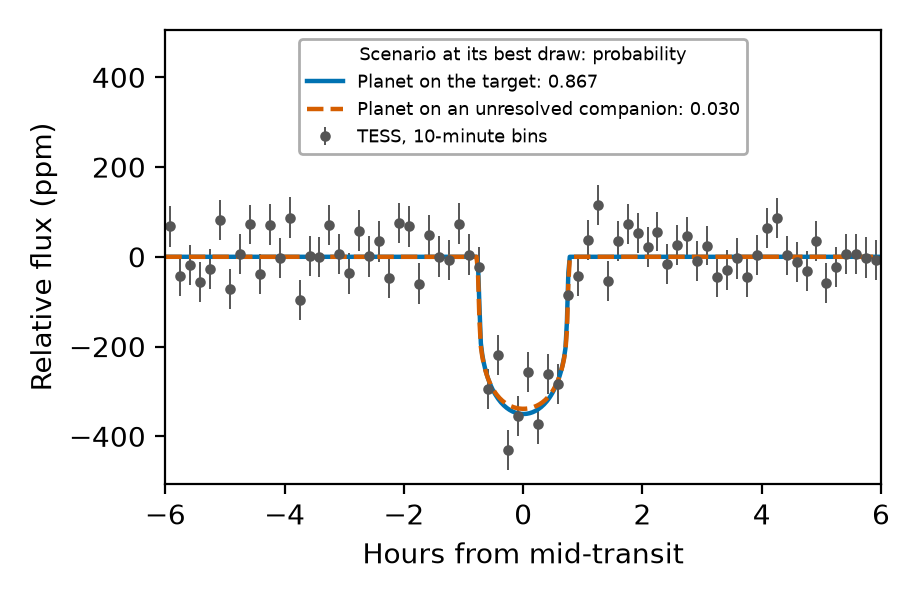

# velociraptor

velociraptor runs the likelihoods of [TRICERATOPS](https://github.com/stevengiacalone/triceratops) on a GPU, with an exact transit light curve, and states the Monte Carlo error of the probabilities that TRICERATOPS reports. TRICERATOPS estimates how likely it is that a transit signal in a TESS light curve is a false positive: an eclipsing binary, a blend with a nearby star or a companion of the target. The draws, the priors and the probabilities are TRICERATOPS's own.

If you use velociraptor, please cite [velociraptor: exact light curves and GPU-accelerated false-positive probabilities for TESS planet candidates](paper/main.pdf), TRICERATOPS and the closed-form light curve; `CITATION.cff` lists the references.

Run on one AMD GPU (Radeon RX 7900 XTX, ROCm 7.2); the CUDA build of torch is not tested. The tests run on the CPU build of torch.



TOI-1411 b, a confirmed planet: three TESS sectors (16, 23, 24) folded on its period, with the planet scenario and the strongest false-positive scenario (a planet on an unresolved companion) at their best draws. `docs/make_figure.py` makes the figure and prints the false-positive probability that velociraptor and TRICERATOPS 1.1.0 give for the same draws, beside the published one (Giacalone et al. 2022, AJ 163, 99).

## Why

A TRICERATOPS calculation weighs the light curve of each scenario against the data for every draw of the scenario's parameters. The cost grows with the draws and the points of the light curve. The default number of draws is 1,000,000, and with `parallel=True` TRICERATOPS builds an array of draws by points in float64, 8 GB at 1,000,000 draws and 1,000 points.

velociraptor moves the three scenario likelihoods of TRICERATOPS 1.1.0 (`lnL_TP_p`, `lnL_EB_p`, `lnL_EB_twin_p`) to a GPU and works in chunks of draws, so that the memory of the device is bounded by the chunk and not by the number of draws. It adds two things:

- **An exact light curve.** The flux of a star with quadratic limb darkening behind a dark disc is the closed form of Agol, Luger and Foreman-Mackey (2020). TRICERATOPS computes it with PyTransit 2.2.0, which departs from the exact curve on short, eccentric orbits (see Agreement).
- **A stated Monte Carlo error.** TRICERATOPS reports one value of the false-positive probability (FPP) and of the nearby-star probability (NFPP) from one run of random draws. `velociraptor.allocation` runs seeded batches of draws and gives the effective sample size of each scenario call and the scatter of the probabilities between batches.

## Installation

velociraptor is not on PyPI; install it from this repository. Install the build of torch for your device first, then velociraptor ([uv's PyTorch guide](https://docs.astral.sh/uv/guides/integration/pytorch/)). Use the index of your torch build: `rocm7.2` for AMD, `cu128` for NVIDIA, `cpu` for the CPU build. The `triceratops` extra adds TRICERATOPS 1.1.0:

```text
uv pip install torch --index-url https://download.pytorch.org/whl/rocm7.2   # cu128 for NVIDIA (not tested), cpu for the CPU build
uv pip install "velociraptor-gpu[triceratops] @ git+https://github.com/mauri870/velociraptor@v0.1.0"
```

velociraptor needs Python 3.12 or later, numpy 1.26 or later and, for the device layer, torch 2.5 or later. The device kernel needs Triton, which the ROCm and CUDA builds of torch install with them. The light curve alone (`quadratic_flux`) needs numpy only. The tests run on Python 3.12 and 3.13. TRICERATOPS 1.1.0 takes numpy below 2 on Python 3.12 and numpy 2.1 or later and scipy 1.14 or later on 3.13; the accuracy tables were computed with numpy 1.26.4, and under numpy 2.1 or later their reference figures differ slightly.

TRICERATOPS 1.1.0 requires PyTransit, which is licensed under the GPL and is installed as TRICERATOPS's own dependency; see Licence.

The `triceratops` extra needs setuptools below 82, which still ships `pkg_resources`; an environment with a newer setuptools fails on `import triceratops.triceratops` until you run `uv pip install "setuptools<82"`.

## Getting started

The light curve needs numpy only:

```python
from velociraptor import quadratic_flux

print(f"{quadratic_flux(z=0.3, k=0.1, u1=0.4, u2=0.2):.5f}")  # 1 is no transit
```

```text
0.98824
```

`z` is the separation of the centres in stellar radii (the sign is ignored), `k` the radius ratio, `u1` and `u2` the quadratic limb-darkening coefficients. Any of them may be an array, and the result has their broadcast shape.

The signal to vet comes from a transit search, for example [transitgpu](https://github.com/mauri870/transitgpu), a GPU transit search for TESS light curves. Build the TRICERATOPS target as usual and run `calc_probs` inside `install`:

```python
import numpy as np
import triceratops.triceratops as tr
from velociraptor.triceratops import install

# Your own light curve, as TRICERATOPS takes it: the phase-folded flux around the transit
# (time in days from mid-transit, flux, flux_err), the orbital period in days and the
# transit depth as a fraction of the flux.
time, flux, flux_err, period, depth = ...

target = tr.target(ID=116483514, sectors=np.array([16, 23, 24]), search_radius=10)
target.calc_depths(tdepth=depth)
with install("cuda"):
    target.calc_probs(time=time, flux_0=flux, flux_err_0=flux_err, P_orb=period, N=100000, parallel=True)
print(target.FPP, target.NFPP)
```

`docs/make_figure.py` runs this for TOI-1411 b: it downloads the light curve from MAST, queries the catalogs for the field and needs the network.

### Choosing the device

`install(device)` takes the name of a torch device. `"cuda"` is the name that torch uses for AMD GPUs too. `"cpu"` runs the torch kernel on the CPU, which serves as a reference and is slow. The kernel is Triton on a device and torch on the CPU; `kernel="torch"` runs the torch kernel on a device. Outside the `with` block TRICERATOPS is unchanged.

## Agreement with TRICERATOPS

Where the light curve of TRICERATOPS is accurate, the log-likelihoods agree. `tests/test_stock_reference.py` holds one draw with its 50-digit reference and compares the log-likelihoods of the two packages on draws where the curves agree. On short, eccentric orbits PyTransit departs from the exact curve, and velociraptor follows the exact one; a probability whose evidence rests on a few such draws differs with them.

The model against references that do not come from velociraptor (the 50-digit arithmetic is `mpmath`; `validation/` has the scripts and `validation/results.json` the results):

<!-- generated: references -->
| Comparison | Cases | Largest difference |
| --- | ---: | ---: |
| Closed form against the lens area, 50 digits (no limb darkening) | 552 | 2.78e-16 |
| Closed form against a two-dimensional integral | 10 | 1.52e-13 |
| Closed form against 768 nodes of the quadrature | 3312 | 6.44e-15 |
| Separation of an orbit, 50 digits (numpy 1.26.4) | 9 | 6.34e-14 |
<!-- end generated: references -->

Against PyTransit 2.2.0, which TRICERATOPS uses (`validation/pytransit_grid.py`, in the environment of `validation/pytransit_env.md`):

<!-- generated: pytransit -->
| Comparison | Cases | Largest difference |
| --- | ---: | ---: |
| PyTransit 2.2.0, flux at a separation | 60 | 3.61e-02 |
| PyTransit 2.2.0, light curve of an orbit | 15 | 1.69e-01 |
<!-- end generated: pytransit -->

## Performance

<!-- generated: headline -->
At the exposure integral of TRICERATOPS (20 midpoints) in float64, the three likelihoods run 1.22 times as fast as the published code, and the whole calculation 1.33 to 2.13 times as fast on 4 stars at 100000 draws. At the default of `install("cuda")` (3 Gauss-Legendre nodes, first pass in float32) the likelihoods run 10.35 times as fast and the whole calculation 3.02 to 8.59 times as fast, with a shift of the false-positive probability of at most 9.1e-06 against 64 nodes on 4 stars. The whole-calculation figures are the paper's Table of the whole-calculation times (medians of 5 on one AMD Radeon RX 7900 XTX and a 32-thread AMD Ryzen 9 9950X3D, one session, the device alone; the author's records, which this repository does not hold); their reference is the published TRICERATOPS code with its host-side lookups of the limb-darkening and stellar tables removed.
<!-- end generated: headline -->

The benchmark times the three scenario likelihoods of TRICERATOPS 1.1.0 with TRICERATOPS's own numba code and with velociraptor on the device and on the CPU. Nothing is read from a file or a network: `benchmarks/bench.py` draws a light curve of 1,000 points with 500 ppm of noise and a 1,000 ppm box, and the draws of a planet, an eclipsing binary and its twin at twice the period, from one seed. One call is the work of one scenario of one star in a TRICERATOPS calculation. Each time is the median of five calls after one that is not counted, in which numba and the device kernel compile, and the copy to the device and back is inside the timer. The last column is the seconds of the numba row over the seconds of the row.

<!-- generated: speed -->
The three scenario likelihoods of TRICERATOPS, 10000 draws and 1000 points each (AMD Ryzen 9 9950X3D 16-Core Processor, AMD Radeon RX 7900 XTX (ROCm 7.2.53211); `bench.py --skip velociraptor-cpu:100000 --json ...`; python 3.12.13, numpy 1.26.4, numba 0.68.1, torch 2.12.0+rocm7.2, triton-rocm 3.7.0, triceratops 1.1.0, pytransit 2.2.0)

| Method | Scenarios | Seconds | Times the numba row |
| --- | ---: | ---: | ---: |
| TRICERATOPS 1.1.0, numba path, 32 threads | 30000 | 0.544 | 1.00 |
| velociraptor, torch on the CPU, 32 threads | 30000 | 69.7 | 0.01 |
| velociraptor, fused kernel on the device, 20 midpoints | 30000 | 0.421 | 1.29 |
| velociraptor, fused kernel on the device, 20 midpoints, first pass in float32 | 30000 | 0.19 | 2.86 |
| velociraptor, fused kernel on the device, 3 Gauss-Legendre nodes in the exposure | 30000 | 0.105 | 5.19 |
| velociraptor, install("cuda") with no arguments: 3 Gauss-Legendre nodes, first pass in float32 | 30000 | 0.0516 | 10.55 |

Note on velociraptor, torch on the CPU, 32 threads: the row measured 42.6, 51.1 and 70.2 s in three runs, with no known cause for the spread; it is a reference path and not a speed to rely on.

The three scenario likelihoods of TRICERATOPS, 100000 draws and 1000 points each (AMD Ryzen 9 9950X3D 16-Core Processor, AMD Radeon RX 7900 XTX (ROCm 7.2.53211); `bench.py --skip velociraptor-cpu:100000 --json ...`; python 3.12.13, numpy 1.26.4, numba 0.68.1, torch 2.12.0+rocm7.2, triton-rocm 3.7.0, triceratops 1.1.0, pytransit 2.2.0)

| Method | Scenarios | Seconds | Times the numba row |
| --- | ---: | ---: | ---: |
| TRICERATOPS 1.1.0, numba path, 32 threads | 300000 | 5.11 | 1.00 |
| velociraptor, fused kernel on the device, 20 midpoints | 300000 | 4.2 | 1.22 |
| velociraptor, fused kernel on the device, 20 midpoints, first pass in float32 | 300000 | 1.9 | 2.70 |
| velociraptor, fused kernel on the device, 3 Gauss-Legendre nodes in the exposure | 300000 | 1.02 | 4.98 |
| velociraptor, install("cuda") with no arguments: 3 Gauss-Legendre nodes, first pass in float32 | 300000 | 0.494 | 10.35 |

Not run: velociraptor, torch on the CPU, 32 threads, because a call of this row took 44 s at 10000 draws and a call at 100000 draws is ten times the work, and the row has six calls.
<!-- end generated: speed -->

The rows at 20 midpoints use `exposure_nodes=None`, the 20 equal parts of the exposure that TRICERATOPS uses. The rows with 3 nodes integrate the exposure with 3 Gauss-Legendre nodes, a different quadrature with its own difference from the 20 midpoints. `install("cuda")` without arguments is the row with 3 nodes and the first pass in float32. The first pass runs the exposure nodes in float32 by default, and the closed form near contact and the chi-squared sum stay in float64; `triton_analytic.PRECISION = "float64"` keeps every step in float64.

The rows time the likelihoods only. A whole TRICERATOPS calculation also draws the scenarios on the CPU, builds the table of probabilities and, for a real target, queries the catalogs, so the whole calculation gains less than the likelihood step. The device does more work on a scenario the larger its radius ratio is, because more pairs of a draw and a point are left to the closed form:

<!-- generated: flagged -->
`flagged.py`, 10000 draws and 1000 points, 20 midpoints

| Scenario | Pairs | Left to the closed form | Share |
| --- | ---: | ---: | ---: |
| planet | 10000000 | 1470487 | 0.147 |
| eclipsing binary | 10000000 | 2632578 | 0.263 |
| twin at twice the period | 10000000 | 3296248 | 0.330 |
<!-- end generated: flagged -->

To reproduce, on every logical CPU of the machine:

```text
env NUMBA_NUM_THREADS=32 OMP_NUM_THREADS=32 uv run --group rocm python benchmarks/bench.py --json session.json
uv run python benchmarks/bench.py --publish session.json
uv run python benchmarks/tables.py
```

`benchmarks/README.md` describes the input, the rows and the timed region, and `benchmarks/results.json` holds every session. `tests/test_tables.py` checks that each table above is what `benchmarks/tables.py` writes from the result files.

## Options

- Float64 in place of the float32 first pass: `triton_analytic.PRECISION = "float64"`. With it a chunked likelihood can differ from an unchunked call in the last bit on a small share of the draws, because the chunks change the order of the sums.
- The exposure integral of TRICERATOPS, 20 equal parts, for a comparison with it: `install("cuda", exposure_nodes=None)`.
- `scenario_streams(seed)`: TRICERATOPS draws every scenario from one global NumPy stream, so leaving one scenario out changes the numbers of all the others. `scenario_streams` gives each call of `calc_probs` a stream of its own, fixed by the seed, the function and the index of the call.

  ```python
  from velociraptor.streams import scenario_streams

  with scenario_streams(seed=7):
      target.calc_probs(time=time, flux_0=flux, flux_err_0=flux_err, P_orb=period, N=100000)
  ```

- `batches(bank, plan, seed)`: seeded batches of draws for each scenario call, with the effective sample size of a call and the scatter of the probabilities between batches (`velociraptor.allocation`).

  ```python
  from velociraptor.allocation import Bank, batch_estimates, batches, effective_sample_size, evidence_report
  from velociraptor.triceratops import install

  def run():
      target.calc_probs(time=time, flux_0=flux, flux_err_0=flux_err, P_orb=period, N=100000, parallel=True)
      return target.FPP, target.NFPP

  bank = Bank()
  with install("cuda"), batches(bank, lambda call: 10, seed=7):
      run()

  effective_sample_size(bank, 0)  # of the first scenario call, over its 10 batches
  batch_estimates(bank, run)      # the probabilities of each batch, pooled, and their error
  evidence_report(bank, run)      # the call that carries the scatter, its batch effective sample size and their ratio
  ```

  `batch_estimates` calls `run` once with all batches pooled and once for each batch, and through `evidence_report` once for each batch of each scenario call; `evidence_report` alone makes the last of these. The banked values stand in for the likelihoods, so a repeat costs the rest of `calc_probs` and not the work on the device.

  `batch_estimates` gives `error`, the standard deviation of the probabilities between batches over the root of the number of batches. The error is the scatter between batches, not a confidence interval: it can be too small where few draws carry the evidence of a call. `evidence_report` names the scenario call whose batches move the output most and gives that call's batch effective sample size, (sum Z)² / sum Z² over the evidences of its batches, and the ratio of that to its number of batches; the size is 1 when one batch carries the sum and the number of batches when they are equal. `batches` runs the calls of `calc_probs` one at a time and suspends the `overlap` of `install`, so a run inside `batches` takes longer than the same `calc_probs` under `install` alone.

## Tests

From a clone, run `uv run --group cpu pytest tests -q`, or `--group rocm` or `--group cu128` for a device build of torch. The tests that may run on a device run their CPU path under the `cpu` group, and those that need PyTransit or Triton skip where it is missing. CI runs the suite on the CPU with Python 3.12 and 3.13.

## Attribution

TRICERATOPS is by Steven Giacalone et al. (Giacalone et al. 2021, AJ 161, 24, doi:10.3847/1538-3881/abc6af), released under the MIT licence; its code is ported in `src/velociraptor/triceratops.py`, and its notice is in `THIRD_PARTY/TRICERATOPS-LICENSE`. The published false-positive probability of TOI-1411 b, in the caption of the figure and in `docs/make_figure.py`, is that of Giacalone et al. (2022, AJ 163, 99, doi:10.3847/1538-3881/ac4334, arXiv:2201.12661, "Validation of 13 Hot and Potentially Terrestrial TESS Planets"). The closed-form light curve is that of Agol, Luger and Foreman-Mackey (2020, AJ 159, 123, doi:10.3847/1538-3881/ab4fee). `separation` and `transit_flux` follow Mandel and Agol (2002, ApJ 580, L171) and serve as the cross-check of the closed form.

## Licence

MIT, see `LICENSE`. Code ported from TRICERATOPS carries its MIT notice (`THIRD_PARTY/TRICERATOPS-LICENSE`). TRICERATOPS 1.1.0 requires PyTransit, which is GPL; velociraptor neither imports nor includes it in its package; its tests and validation scripts import it for the comparison with the exact light curve.
